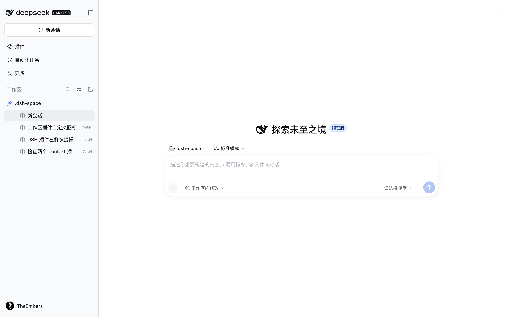
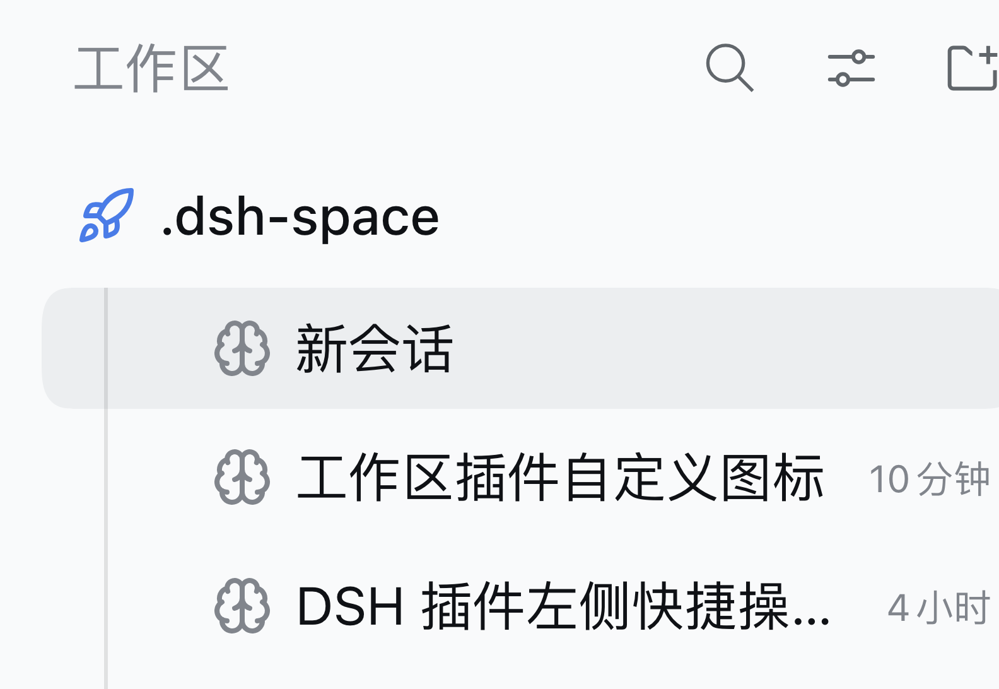
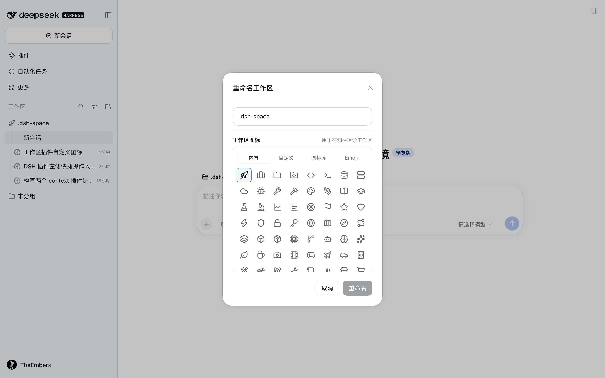
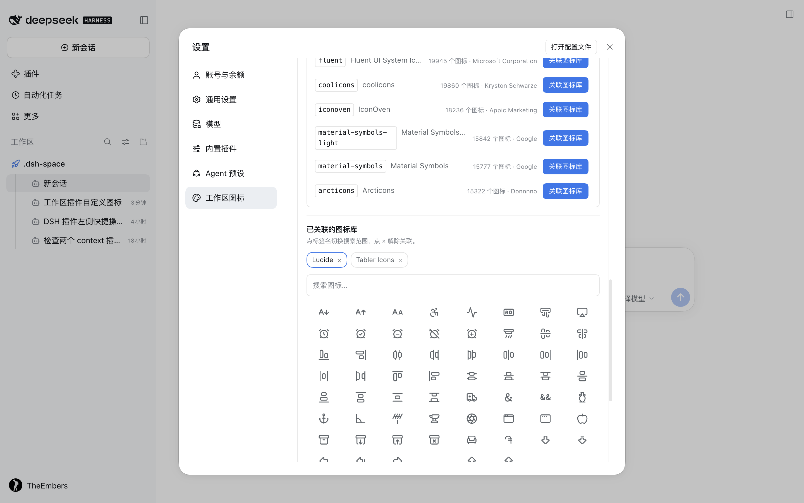
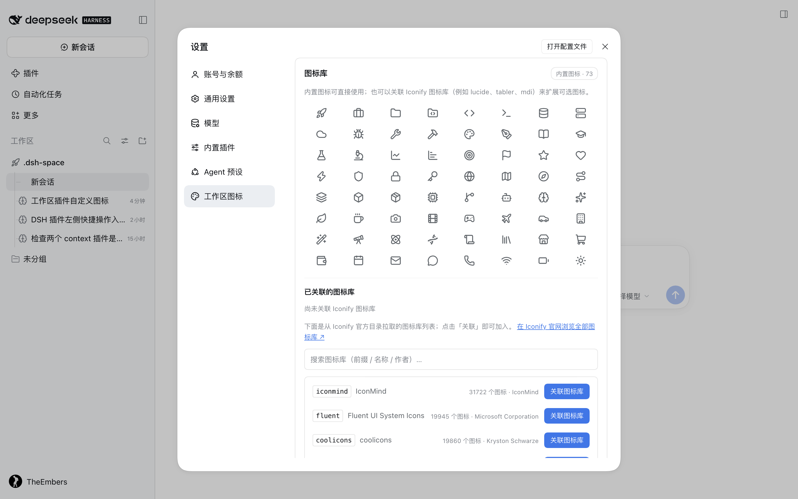

# dsh-workspace-icons

**Workspace & session icons for the DeepSeek Harness sidebar.**
为 [DeepSeek Harness](https://github.com/deepseek-ai/dsh) 的侧栏工作区与会话添加自定义图标。

- **工作区图标** — 在「重命名工作区」弹窗里直接选择图标，已设置的图标显示在工作区名称左侧。
- **会话默认图标** — 给本地发起（非 IM 渠道）的会话显示一个默认图标；已有 IM 渠道 logo/头像的会话自动让位。
- **层级样式** — 会话行相对工作区多缩进一级，并从工作区图标正下方垂一条竖直引导线，把「工作区 → 会话」画成清晰的两级结构。
- **图标来源** — 73 个内置 Lucide 图标、自定义 SVG 上传、关联任意 [Iconify](https://iconify.design) 图标库（内置官方目录与搜索，一键关联）。
- **跟随主题** — 不提供自定义颜色，图标与宿主侧栏自己的图标同色；选中行时不会跟着文字一起变深。

Workspace icons are picked inside the existing *Rename workspace* dialog — no separate entry point is added to the sidebar. Session icons deliberately yield to IM channel logos, so a session started from WeChat/Feishu keeps its own avatar.

## 预览

| 侧栏图标 | 层级缩进 | 重命名弹窗 | 设置页（⌘,） | 图标库目录 |
| --- | --- | --- | --- | --- |
|  |  |  |  |  |

## 安装

```sh
# 从 GitHub 安装到某个 profile（把 <profile> 换成 desktop / web / …）
dsh plugin --profile <profile> add github:Theembers/dsh-workspace-icons

# 然后重启对应的 DSH 进程
```

包里的 `lib/client.js` 已经构建好并随仓库发布，安装时不需要跑任何构建脚本。

> 由 Electron 应用托管的 profile（例如 `desktop`）会被 CLI 拒绝写入（`profile is managed exclusively by the Electron application`），此时请在应用的插件管理界面安装，或手动修改 profile 的 `package.json` 与 `node_modules` 软链。

安装后**设置**面板左侧导航出现「工作区图标」一节（快捷键 ⌘, / ⌘⌥,）；「重命名工作区」弹窗内出现图标选择区。插件不在侧栏单独占入口。

## 使用

1. **给工作区设置图标**：右键工作区 → 重命名 → 在输入框下方选择图标 → 点「重命名」。名称和图标一起保存；只改图标时「重命名」按钮会被自动点亮，图标不会影响工作区名称。
2. **默认工作区图标**：设置 → 工作区图标 → 默认工作区图标。未单独设置图标的工作区都会显示它。
3. **默认会话图标**：设置 → 会话图标。只对没有 IM 渠道的会话生效。
4. **图标库**：设置 → 工作区图标 → 图标库。
   - **Iconify 官方目录**（`api.iconify.design/collections`，共 276 个图标库，按图标数排序），每行显示前缀、名称、图标数量和作者；点「关联图标库」即可加入。
   - 搜索框支持按前缀 / 名称 / 作者过滤（如 `tabler`、`material`、`Google`）。
   - 「在 Iconify 官网浏览全部图标库 ↗」可跳到 <https://icon-sets.iconify.design/> 查看完整清单。
   - 卡片底部是「已关联的图标库」标签行：**点标签名**切换下方「搜索图标…」的搜索范围（当前范围高亮），**点标签上的 ×** 解除关联。
   - 关联之后，在任意图标选择器的「图标库」页签（重命名弹窗、设置页「更改图标」）就能按库搜索并选用；该页签的「搜索图标…」框在已关联库内按图标名过滤（子串匹配）。
5. **自定义图标**：设置 → 自定义图标 → 上传 SVG（≤64KB）。

## 配置

配置文件：`~/.dsh/dsh-workspace-icons/config.json`

```jsonc
{
  "version": 1,
  "libraries": { "iconify": [{ "prefix": "lucide", "title": "Lucide", "total": 2029, "linkedAt": "..." }] },
  "customIcons": [{ "id": "ci_xxx", "name": "rocket", "kind": "svg", "svg": "<svg…>" }],
  "workspaceIcons": { "<workspaceId>": { "type": "builtin", "name": "rocket" } },
  "defaults": { "workspace": { "type": "builtin", "name": "folder-code" }, "session": { "type": "builtin", "name": "sparkles" } },
  "settings": { "showDefaultWorkspaceIcon": true, "showDefaultSessionIcon": true }
}
```

图标引用（iconRef）形态：

| type | 形态 |
| --- | --- |
| builtin | `{ "type": "builtin", "name": "rocket" }` |
| iconify | `{ "type": "iconify", "prefix": "lucide", "name": "rocket" }` |
| custom | `{ "type": "custom", "id": "ci_xxx" }` |

Iconify 元数据、SVG、整页图标包与图标库目录缓存在 `~/.dsh/dsh-workspace-icons/cache/`（24 小时）。

**为什么整页图标是一次请求**：Iconify 的公开 API 会按来源 IP 限流（实测连续 96 次单图标请求只成功 16 次，其余 429）。所以搜索结果不会逐个图标去取图，而是用批量接口 `GET /{prefix}.json?icons=a,b,c` **一次取回整页图标**，在服务端转成内联 SVG data URI 一起返回。失败时逐图标接口仍可用作兜底。

**解除关联的副作用**：解除关联会同时清掉所有引用该库的工作区图标与默认图标（接口返回 `cleaned` 计数）。

## 开发

```sh
node scripts/build-client.mjs      # client-src/*.js → lib/client.js
node --check lib/client.js
node --test scripts/host.test.mjs  # 宿主侧单元测试
```

- `client-src/`：浏览器侧源码。`shared.js` 是共享层（数据、图标渲染、IconPicker），`styles.js` 是样式（类名前缀 `dwi-`），`builtin-icons.js` 是内置图标数据。
- `lib/index.js`：宿主 Cordis 插件（配置存储 + REST + Iconify 代理）。
- `lib/client.js`：由构建脚本生成，**不要手改**。
- 客户端模块契约与 DSH DOM/slot 事实：`client-src/CONTRACT.md`。

## 实现说明与兼容性

- 要求 DSH `>=0.2.2-rc.1 <0.3.0-0`（基于 `__ModuleLoader__` 客户端插件、`sidebar.workspaces` 槽位与侧栏 DOM 结构）。
- 工作区图标通过 DOM 装饰实现（DSH 工作区行没有 icon 槽位）；重命名弹窗通过 React fiber 读取 `workspaceId`。若上游 DOM 结构变化，需要更新 `client-src/overlay-workspaces.js` / `rename-icon.js` 中的选择器。
- 装饰标记用自定义 attribute（`data-dwi-folder-host`）而不是 class：宿主每次重渲染都会重写 folder 槽的 `className`，class 会被冲掉，图标会闪一下原生文件夹。
- 层级样式同样通过 DOM 装饰实现（`client-src/hierarchy.js`）：宿主把工作区行与它的会话行放在同一个 `groupSection` 里、缩进完全相同，插件给会话行额外加一级缩进，并在每条会话行上画一段竖线（每段向下多画 2px 去盖住宿主行间那 2px 的 margin，相邻段首尾相接、不重叠；本组最后一行不再外扩，避免线尾拖进下一组间距）。
- 竖线的横向位置有两处补偿：① 宿主的每一行都带 3px 透明左边框（给激活指示器预留），而绝对定位伪元素的包含块是行的 padding box，不减掉这 3px 线会整体右偏 3px —— 插件运行时量一次该值写进 `--dwi-row-border`；② 线宽 1px 时 Chromium 会把背景按整像素对齐绘制，只能落在半像素位置，所以改用「2px 盒子 + 渐变只涂中间 1px」，让线精确落在图标中心（偏差 0px）。
- 会话图标的伪元素画在标题 span 内部，和 IM 插件（`@xmanrui/dsh-im`）的渠道 logo 同源，因此 GUI 会话与 IM 会话的文字起点完全一致。宿主 leading slot 固定 16px 宽（会话运行时会在里面居中渲染 14px 的 loading spinner，IM 插件也往同一个 slot 放过 bot 头像），所以引导线特意放在 slot 左侧的行缘处，跟这些状态图形天然错开。
- 设置入口使用 `settings.section` 槽位。宿主在「标题未改动」时会把「重命名」按钮置灰，插件在图标有改动时摘掉该 `disabled`，因此图标与名称共用一个提交入口。

## License

MIT
